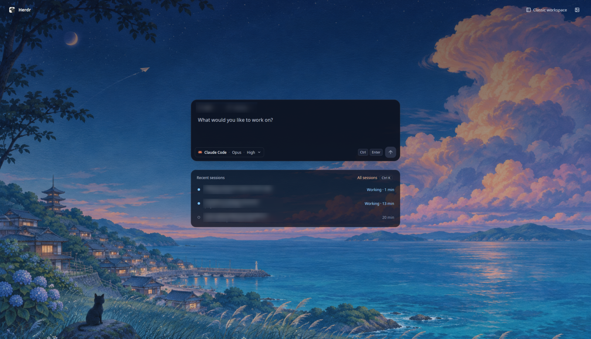

# Focus for Herdr

A [Herdr](https://herdr.dev) layout that puts one thing on screen: what you want an agent to do. A single composer over a painted background, the sessions that need you just below it, and once you start, the agent's terminal centered on the same background, with nothing else around it.

- **One composer**: the project folder and its branch, the task, and one button for agent, model and effort (Claude Code, Codex and the other agents Herdr knows), remembered per project. Ctrl+Enter starts it.
- **Recent sessions** under the composer: the ones waiting for you first, then the ones working, with how long they have been at it.
- **A quiet session window**: the agent's terminal and its title bar (task, folder, branch, agent, state) in one card that gets the keyboard at once, the other sessions as pills below it, and Review changes, Close and Next task once the agent is done.
- **All sessions** (Ctrl+K on the composer, or the Sessions button): search, grouped by Needs you, Working, Finished, and the keyboard to move.
- **Projects are folders**: one entry per folder, no duplicates, and "No Git repository" where there is none.
- **Your own background**: pick an image, fill or fit, or a solid color.
- **Classic workspace** is one click away, and Ctrl+Alt+Space brings Focus back.

## Add it

Paste this into your agent, in Herdr:

> Add the Herdr layout from https://github.com/alarboulletmarin/herdr-focus

`RECIPE.md` describes the layout in full, to build it again from scratch.

Icons from [Lucide](https://lucide.dev) (ISC).
