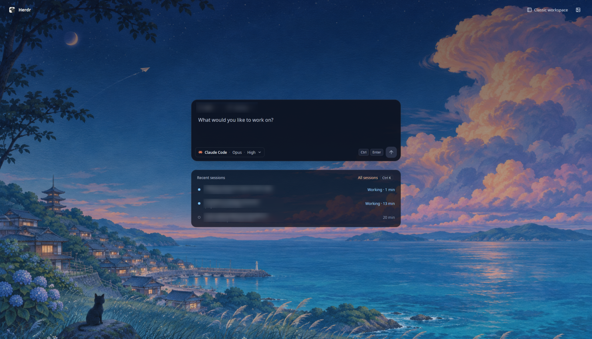

# Focus

A launcher-first Herdr layout: a single composer over a full-window painting, the sessions that need you below it, and a session view where the agent's terminal sits alone in a centered card on the same painting. No sidebar, no tab bar.

## What you see

**Colors.** Night blue surfaces that sit on the painting and one fixed peach accent: card `#0d1220ed`, list `#0a0e1abd`, raised `#1c2438`, lines `#ffffff17` / `#ffffff12`, text `#f2f4f8`, muted `#c3cad9`, sub `#aab2c5`, dim `#8d96ab`, faint `#5d6680`, accent `#f6c1a0` (hover `#ffd9c2`, ink `#2a1810`, focus ring `#f6c1a061`), working `#7cc4ff` (text `#9fd3ff`), blocked `#ffb35c` (text `#ffc98a`, halo `#ffb35c2e`), errors `#ff9a9a`. UI font Noto Sans. The terminal theme `focus` has a `#0c111d` background, `#c9cfdc` text, a peach cursor.

**Home** (the default child of the `focus-content` stack), over the background image with a top-down scrim gradient `#060a1699` → transparent:

- **A 64px header**: the Herdr mark (22px, 5px radius) and "Herdr" 14px semibold on the left; on the right "Classic workspace" (panel icon) and an icon-only Background button (image icon), both 34px high, `#d5dae6`, hover `#ffffff14`.
- **The composer**, centered, at most 680px wide, starting 40% of the way down the free height: a 200px card, 20px radius, 1px line border (the focus ring color while typing), `shadow_xl`.
  - A 42px row of chips: folder icon + the folder's own name ("~" for home) + chevron; "/"; then the branch (git-branch icon + chevron) or "No Git repository" in dim, not clickable.
  - A 100px, 16px textarea: "What would you like to work on?".
  - A 56px row: the agent chip (its icon, name semibold, "· model · effort", chevron; 32px, 1px border), then on the right the Ctrl / Enter key caps and a 36px send button (accent when there is text and an installed agent, `#2a3248` otherwise) with an up arrow.
- **Recent sessions**, 28px below: a list card (16px radius) titled "Recent sessions" with "All sessions" and a Ctrl K cap on the right, then up to three rows (only as many as fit the window height, none rather than clipped): a status dot (blocked: an 8px orange dot in a 14px halo; working: a blue dot; otherwise a 1px dim ring), the session's name 13px medium, "space / branch · agent" 12px dim, and on the right "Needs you", "Working · 4 min", "Done · 1 h" or the time since it changed. Hidden when there is no agent session.
- **The agent popover**, 8px under the card: three columns (Agent, Model with a filter field, Effort), checks on the chosen rows, "Check installed agents again" and "Saved for this project." in small dim text. Agents Herdr can't configure show the Agent column only.
- **The projects / branches popover**, under the chip row: a filter field and the list (folder name, its parent folder or machine on the right), then "Choose a folder…".

**Session** (the `focus-session` child): a `#060a1647` veil over the painting.

- **A 60px header** on a `#060a16b8` → `#060a1640` gradient, draggable: "+ New task", a hairline, then the session's name 14px semibold over "folder / branch · agent · model · effort" 11px (branch only inside Git; agent details from 980px), a status pill when working ("Working · 2 min", blue) or blocked ("Needs you", orange), then on the right Sessions (with an orange count of the other sessions waiting for you), Background and Classic workspace.
- **The terminal**: the shown tab in one card, 16px radius, `#0b0f1a`, 1px `#ffffff14` border, 18 × 22px terminal padding, 0.95 opacity, between two flexible margins (1 : 10 : 1, at least 16px each), 8px from the header and 16px from the bottom.

**All sessions**: a 620 × 520 dialog: a 56px search row (search icon, "Search sessions, projects, branches…", Esc cap), the sessions grouped under NEEDS YOU (orange), WORKING, FINISHED, EARLIER and TERMINALS, the selected row lighter with an Enter cap, and a footer with ↑ ↓ "to move" and "Open classic workspace".

**Background**: a dialog to pick an image (the system picker, a pasted path, or a dropped file; PNG, JPEG, WebP, GIF under 8 MB, copied into `backgrounds/focus`), Fill or Fit, or Solid.

## How it behaves

- **Starting a task**: Ctrl+Enter or the send button. It opens a tab named after the task in the folder's space (or a new space for a folder without one), with the agent's command, model and effort flags (`--model`, Claude's `--effort`, Codex's `model_reasoning_effort` and `--no-daemon`), switches to the session view and gives the new terminal the keyboard. The task is passed as a structured argument, never through a shell. A second press while starting does nothing.
- **Statuses**: blocked shows "Needs you" in orange and sorts first everywhere; working is blue with the time since it started; done shows "Done · time"; idle shows the time since it changed; terminals without an agent are listed last in All sessions only.
- **Names**: a tab someone named keeps its name; an unnamed one shows its terminal's title without spinner glyphs, or "Session N".
- **Projects** are the folders the spaces start in and their terminals are in now, one entry per folder and machine. A space's name follows its first terminal, so it can name another folder: the menu shows folders. Choosing one reads its branch and worktrees; agent, model and effort are remembered per folder.
- **Popovers**: Esc or a press outside closes them. They stop the mouse press, so a click on a row never reaches the session row drawn underneath.
- **Opening a session** (a recent row, All sessions, Enter) selects its space and tab, shows the session view and focuses its terminal. You type to the agent in its own terminal.
- **Keys**: Ctrl+Enter starts, Ctrl+K opens All sessions from the composer, ↑ ↓ Enter in All sessions, Esc closes, Ctrl+Alt+Space (`keys.json`) switches to Focus.
- **Sizes** follow the app's zoom: window sizes are divided by `settings().zoom` before deciding what fits.
- Times refresh every 30 seconds; everything else follows Herdr's live data.

## Built from

- `layouts/focus.json`: a root column (theme `focus`, the colors above as theme overrides, background image `backgrounds/focus/blue-hour.jpg` cover, `ui_font` Noto Sans, `preview`) holding the stack `focus-content`:
  - `focus-home`: a block with mod `focus`.
  - `focus-session`: a column, not resizable: `focus-chrome` (block, 60px, `window_drag`, mod `focus-chrome`), `focus-body` (a row with padding [8, 0]: empty columns `focus-left` / `focus-right` of weight 1, min 16, around `focus-main`, weight 10, holding `focus-output`: `{ "tab": "active", "pane": { … "lone": true } }`), and `focus-foot` (an empty 16px column).
  - Both mod blocks accept a `classic` prop: the layout the Classic workspace buttons switch to (default `main`).
- `themes/focus.json`: the terminal colors.
- `mods/focus`: the composer, its popovers and Recent sessions. `logic.js` (launch request, worktree parsing, the project list), `options.js` (model catalogs from `~/.codex/models_cache.json` and Claude's aliases, agent flags), `sessions.js` and `palette.js` (shared with `focus-chrome`).
- `mods/focus-chrome`: the session header, and All sessions when opened with `props: { sessions: true }`.
- `mods/focus-backgrounds`: the background dialog; it runs `zenity` for the file picker when present.
- Herdr's own assets: `mods/workspace-chrome/*.svg` icons and `frame/welcome/herdr.png`.
- `herdr`: `spaces`, `agents`, `panes`, `knownAgents`, `exec` (`git worktree list`, `git rev-parse`), `readTextFile`, `pickFolder`, `shared` / `setShared` (`focus.draft`, `focus.preferences`, `focus.sessions`, `focus.background`), `openOverlay`, `settings`, `run` with `tab.new`, `space.new`, `space.select`, `tab.select`, `pane.focus`, `layout.select`, `layout.switch`, `layout.set`.

## Watch out

- gpui-kit has no occlusion: an absolutely placed popover lets clicks through to what is drawn under it. Stop the press on the popover (`on_mouse_down("left", cx => cx.stop_propagation())`).
- There is no `deferred()`: a popover paints over later siblings only if it is the last child, so it is placed absolutely at known offsets (the card has a fixed 200px height).
- `bg()` in a mod takes colors only: gradients go on layout nodes.
- Layout blocks need content: empty spacers are columns with no children.
- Mods can't import from one another: `sessions.js` and `palette.js` exist twice and a test keeps the copies identical.
- `on_size_change` reports window pixels while mod sizes grow with zoom: divide by `settings().zoom`.
- The terminal background comes from the theme, not from the pane frame: that is why the layout has its own theme.
- Don't add a second input for the agent: the agent's terminal already has one.
- Noto Sans falls back to the system UI font where it isn't installed.

## Done when

- `herdr-app check` passes for `mods/focus`, `mods/focus-chrome` and `mods/focus-backgrounds`.
- `node mods/focus/tests/sessions.test.mjs` and `node --experimental-vm-modules mods/focus/tests/flow.test.mjs` pass.
- Writing a task and pressing Ctrl+Enter opens a tab in the chosen folder with the chosen agent, shows the session view, and typing goes to the agent's terminal.
- Choosing an agent, model or effort over the Recent sessions list changes only the choice; no session opens.
- A folder without Git shows "No Git repository"; two spaces in the same folder give one project.
- At zoom 1.5 the Recent sessions list never runs off the window.
